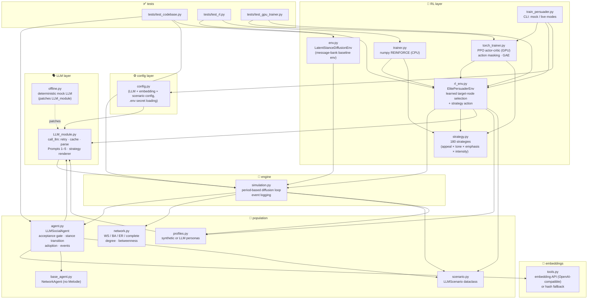
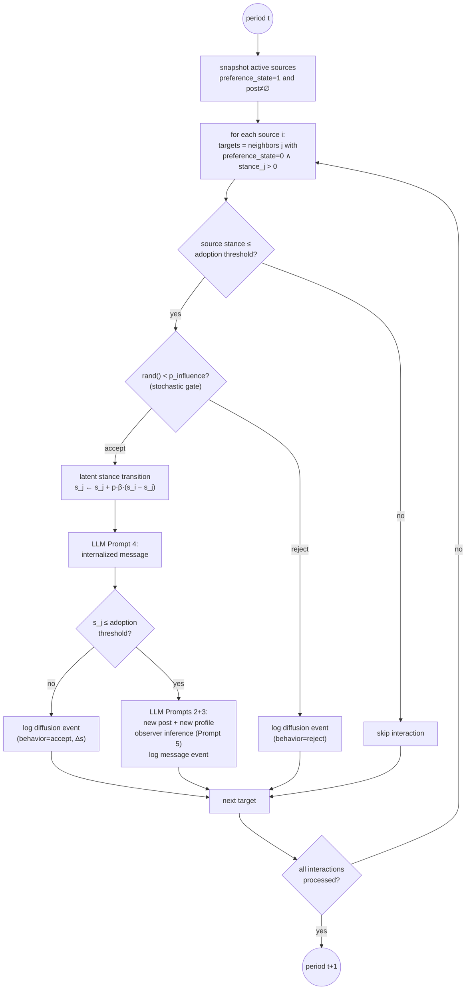
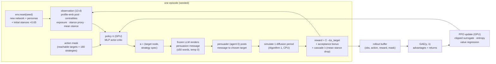
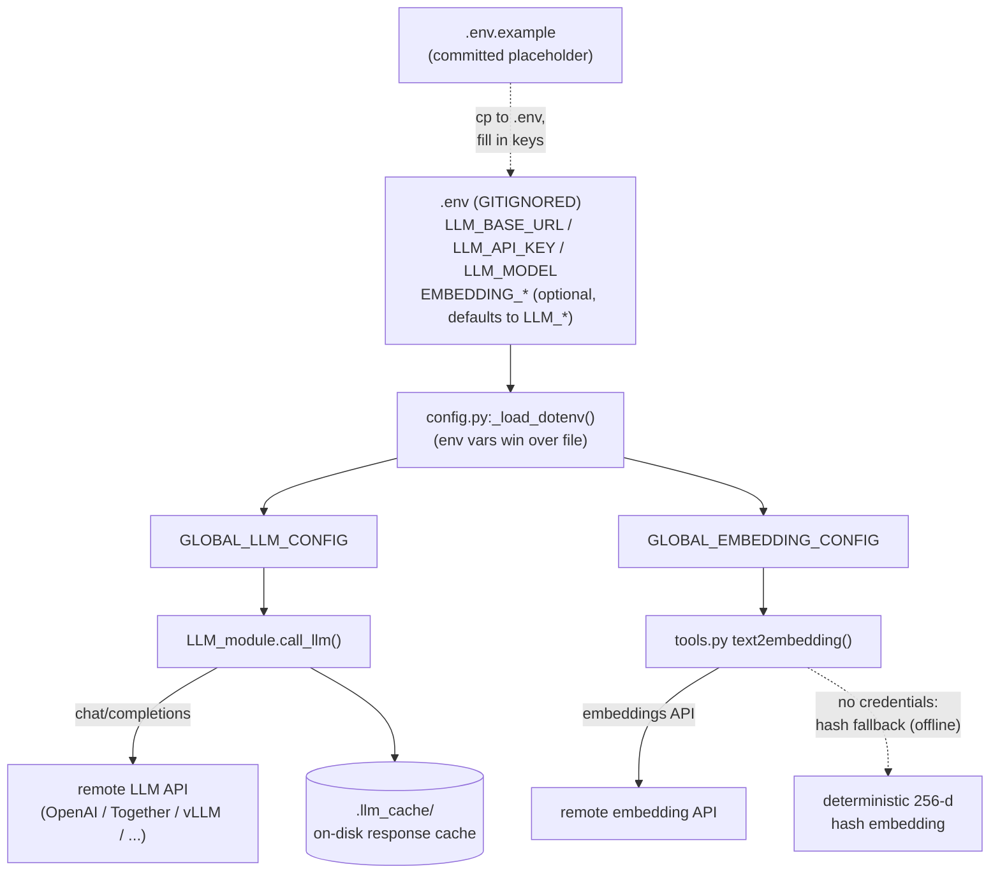

# Codebase Graphify — Architecture Diagrams

Visual maps of the agentic information-diffusion system and its RL
training pipeline. All diagrams are [Mermaid](https://mermaid.js.org):
they render on GitHub/GitLab and in VS Code (with a mermaid plugin).

---

## 1. Module dependency graph

Who imports whom (arrows point from importer to imported module).

---

## 2. One diffusion period (paper Algorithm 1, as implemented)

---

## 3. RL training loop (GPU PPO + LLM renderer + simulator)

---

## 4. Secrets & external services

No local LLMs or embedding models are run — everything goes through
external OpenAI-compatible APIs configured in the gitignored `.env`.

---

## 5. Module responsibility table

| Module | Responsibility | Key classes/functions |
|---|---|---|
| `config.py` | LLM + embedding + scenario config, `.env` secret loading | `LLMConfig`, `EmbeddingConfig` |
| `LLM_module.py` | LLM calls, retries, cache, prompt bank | `call_llm`, `render_strategy_message`, Prompts 1–5 |
| `tools.py` | embeddings via external API or hash fallback | `text2embedding` |
| `base_agent.py` | minimal agent base (Melodie-free) | `NetworkAgent` |
| `agent.py` | stance dynamics, acceptance gate, adoption, events | `LLMSocialAgent.infection_impact` |
| `network.py` | topology + centralities | `build_network` |
| `profiles.py` | persona generation (synthetic or LLM) | `generate_synthetic_profiles` |
| `scenario.py` | experiment parameters | `LLMScenario` |
| `simulation.py` | diffusion engine | `Simulation`, `generate_profiles` |
| `strategy.py` | 180-dim persuasion strategy space | `StrategySpec`, `index_to_strategy` |
| `rl_env.py` | persuader env: learned target + strategy actions | `ElitePersuaderEnv` |
| `env.py` | legacy message-bank env | `LatentStanceDiffusionEnv` |
| `trainer.py` | CPU REINFORCE baseline | `RLPolicy`, `train` |
| `torch_trainer.py` | GPU PPO (action masking, GAE) | `PPOTrainer`, `ActorCritic` |
| `train_persuader.py` | training CLI (mock/live) | `main` |
| `offline.py` | mock LLM backend | `install` |
